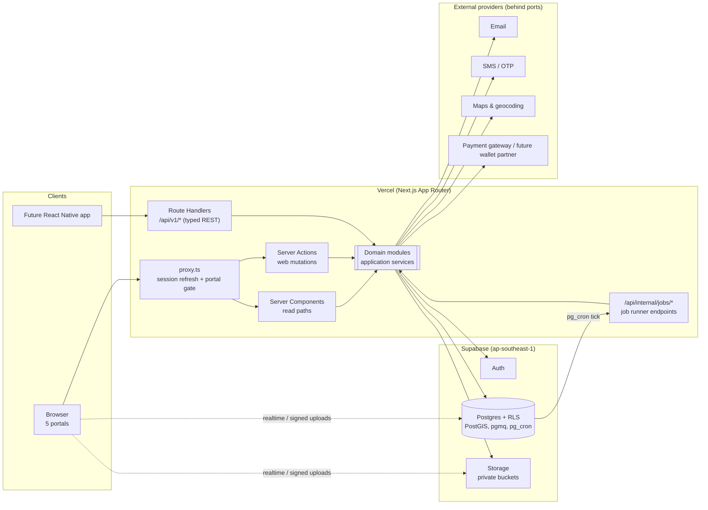

# 01 · Architecture Overview

## 1. Architectural style

Bahay+ is a **modular monolith**: one deployable Next.js application backed by one Supabase project, internally divided into domain modules with explicit public APIs.

Why not microservices: the team is small, the domains share one tenancy model (households + organizations) and one Postgres database with RLS, and most workflows (booking → work order → expense → calendar) cross several domains inside a single transaction. Splitting now would add network failure modes, distributed transactions and duplicated authorization without a scaling need. Module boundaries are drawn so that a module *could* be extracted later (see [03](./03-domain-modules.md)).

## 2. Runtime topology



### Request paths

| Path | Used by | Notes |
|------|---------|-------|
| Server Components → module query services | Web portals (reads) | User-scoped Supabase client so RLS applies |
| Server Actions → module command services | Web portals (writes) | Thin adapters: parse with Zod contract, call service, map `Result` |
| Route Handlers `/api/v1/*` → same services | Future mobile app, integrations | Bearer token auth; same contracts as Server Actions |
| `/api/internal/jobs/*` | pg_cron / Vercel Cron | Shared-secret auth; service-role client; idempotent |
| Browser → Supabase directly | Realtime subscriptions, signed Storage uploads | Never for business writes |

## 3. Layering inside the app

```
Presentation (app/, components/)        ← React, Next.js, shadcn/ui
        │  calls
Adapters (server actions, route handlers)  ← auth context, Zod parse, error mapping
        │  calls
Application services (modules/*/application) ← use cases, authorization policy, transactions
        │  uses
Domain (modules/*/domain)               ← pure TS: entities, value objects, rules
        │
Infrastructure (modules/*/infrastructure) ← Supabase repositories, provider adapters
```

Rules (enforced by ESLint import boundaries — see [02](./02-repository-structure.md#import-rules)):

- `domain/` imports nothing framework-specific (no `next/*`, no `react`, no Supabase).
- `application/` may import `domain/`, contracts and **ports** (interfaces), never Next.js.
- UI components never contain business rules; they render state and call actions.

## 4. Cross-cutting concerns

| Concern | Approach |
|---------|----------|
| **Tenancy** | Every tenant-owned row carries `household_id` or `organization_id`. RLS enforces access. Active context is in the URL, not session state ([05](./05-auth.md)). |
| **Money** | `bigint` centavos + `currency = 'PHP'` check constraint. `Money` value object in the shared kernel. No floats anywhere. |
| **Time** | `timestamptz` stored UTC; rendered in `Asia/Manila`. Date-only facts (due dates, birthdays) use `date` and are interpreted in Manila. The Philippines has no DST, but code never assumes a fixed offset. |
| **Validation** | Zod contracts validated on the server for every input, re-used by React Hook Form on the client for UX only. |
| **Audit** | `private.audit_log` written by application services (who, what, context, before/after diff) for sensitive actions; append-only. |
| **Idempotency** | `Idempotency-Key` on financial and booking-creation commands; `idempotency_keys` table with request hash + stored response. Jobs are keyed by natural keys (e.g. `reminder_id + due_at`). |
| **Background work** | Durable Postgres queue (pgmq) + transactional outbox; pg_cron ticks a protected job endpoint. Retries with backoff, dead-letter table. |
| **Files** | Private Supabase Storage buckets; object paths prefixed by tenant (`households/{id}/…`); Storage RLS policies mirror table RLS; signed URLs with short TTL. |
| **Notifications** | `NotificationChannel` port (email, SMS, in-app; push later). Preferences per user. |
| **External integrations** | Every vendor sits behind a port interface in `src/platform/*/ports.ts`, with a fake adapter for tests. |
| **Observability** | Structured logs with `requestId`, error tracking (Sentry or equivalent — open decision), Vercel analytics. No PII in logs. |
| **Security** | Service-role key only in `server-only` modules; CSP headers; rate limiting on auth and public endpoints; DPA (RA 10173) aligned data handling. |
| **i18n** | English first; strings centralized so Filipino can be added (open decision). Currency formatted `₱1,234.50` via `Intl.NumberFormat('en-PH')`. |

## 5. Portals

All five portals live in **one** Next.js application as route groups with their own layouts:

| Portal | Path | Audience | Layout bias |
|--------|------|----------|-------------|
| Customer | `/app` | Household members | Mobile-first, bottom navigation |
| Service Provider | `/provider` | Provider org staff | Desktop-first, collapsible sidebar |
| Supplier | `/supplier` | Supplier org staff | Desktop-first, collapsible sidebar |
| Field Worker | `/worker` | Field staff of provider orgs | Mobile-first, task-focused |
| Super Admin | `/admin` | Platform operators | Desktop-first, dense tables |

A single user can hold memberships in several households and organizations. Portals show a **context switcher** listing only contexts the user belongs to; the selected context is part of the URL (`/app/h/[householdId]/…`, `/provider/[orgSlug]/…`) so multiple tabs can work in different contexts safely.

## 6. Payments posture

Bahay+ does **not** hold customer funds. The payments module exposes a `PaymentGateway` port and an internal payment ledger with states (`pending → authorized → captured → refunded/failed`). Initial adapter: `manual` (records cash/off-platform payments as *recorded*, never as *processed*). A licensed partner (PSP or e-money issuer) can be added as a new adapter later; the Bahay+ Wallet would be one such adapter. Details in [04](./04-data-model.md#payments-and-the-future-wallet).
