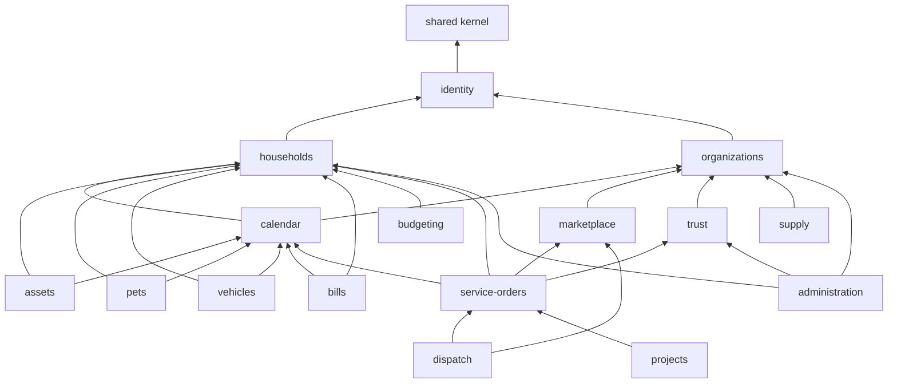

# 03 · Domain Modules

Each approved domain maps to a module under `src/modules/`. Closely coupled domains share a module where splitting would only add ceremony; the mapping is explicit below.

## Module map

| Module           | Approved domain(s)                                 | Owns (tables)                                                                                                                                 | Primary portals                    |
| ---------------- | -------------------------------------------------- | --------------------------------------------------------------------------------------------------------------------------------------------- | ---------------------------------- |
| `identity`       | 1 Authentication & authorization                   | `profiles`, `platform_admins`, contexts/role resolution                                                                                       | all                                |
| `households`     | 2 Household & property · 3 Members & permissions   | `households`, `properties`, `household_people`, `household_members`, `household_invitations`                                                  | `/app`                             |
| `assets`         | 4 Asset registry                                   | `assets`, `asset_service_records`, warranty data                                                                                              | `/app`                             |
| `pets`           | 5 Pets & pet care                                  | `pets`, `pet_health_records`                                                                                                                  | `/app`                             |
| `vehicles`       | 6 Vehicles & vehicle care                          | `vehicles`, `vehicle_service_records`, registration/insurance dates                                                                           | `/app`                             |
| `bills`          | 7 Bills & utilities                                | `billers` (catalog), `bill_accounts`, `bills`, `bill_payment_records`                                                                         | `/app`, `/admin` (catalog)         |
| `budgeting`      | 8 Budgeting & expenses                             | `budgets`, `budget_lines`, `expense_categories`, `expenses`                                                                                   | `/app`                             |
| `calendar`       | 9 Calendar & reminders                             | `calendar_items`, `reminders`, `reminder_occurrences`                                                                                         | `/app`, `/worker`                  |
| `marketplace`    | 10 Home services marketplace                       | `service_categories`, `provider_services`, `service_areas`, search projections                                                                | `/app`, `/provider`, `/admin`      |
| `trust`          | 11 Provider trust & verification                   | `verification_requests`, `verification_documents`, `trust_levels`, `reviews`                                                                  | `/provider`, `/admin`, `/app`      |
| `dispatch`       | 12 Urgent provider discovery                       | `urgent_requests`, `urgent_offers`                                                                                                            | `/app`, `/provider`                |
| `service-orders` | 13 Bookings, quotations, appointments, work orders | `service_requests`, `quotations`, `quotation_lines`, `bookings`, `appointments`, `work_orders`, `work_order_assignments`, `work_order_events` | `/app`, `/provider`, `/worker`     |
| `projects`       | 14 Renovation & custom projects                    | `projects`, `project_milestones`, `change_orders`, `project_documents`                                                                        | `/app`, `/provider`                |
| `supply`         | 15 Supplier, inventory & logistics                 | `products`, `stock_locations`, `stock_movements`, `purchase_orders`, `purchase_order_lines`, `deliveries`                                     | `/supplier`, `/provider`           |
| `organizations`  | 16 Business & administrative operations            | `organizations`, `organization_members`, `organization_invitations`, `organization_locations`, staff schedules, business reports              | `/provider`, `/supplier`, `/admin` |
| `administration` | 16 (platform side)                                 | admin views, moderation, disputes, feature flags                                                                                              | `/admin`                           |

Platform services (`src/platform/`) are not domains: `audit`, `jobs`, `notifications`, `payments`, `storage`, `idempotency`, `auth`.

## Dependency direction

Arrows point from a module to what it depends on. Lower layers never depend on upper ones. Cross-module calls go through the target module's `index.ts` only.



Notable rules:

- **Calendar is a sink**, not a hub. Modules push items into it (`calendar.upsertItem(...)`) in the same transaction as their own write; calendar never reads other modules' tables. This keeps the dependency acyclic.
- **Budgeting does not know about bills or bookings.** When a bill payment is recorded or a booking completes, the source module emits a domain event via the outbox; a budgeting handler creates the expense with `source_type/source_id` for traceability. This is the one place we accept eventual consistency, because expenses are derived data.
- **Trust is read by marketplace/service-orders** (e.g. "only verified providers can receive urgent requests"), but trust never calls them.
- **Payments is platform**, not a domain module, so the future wallet can plug in without touching service-orders.

## Domain events (outbox)

Events are written to `private.outbox` in the producing transaction and dispatched by the job runner. Initial catalogue:

| Event                      | Producer       | Consumers                                        |
| -------------------------- | -------------- | ------------------------------------------------ |
| `household.member_invited` | households     | notifications                                    |
| `bill.payment_recorded`    | bills          | budgeting, calendar                              |
| `booking.confirmed`        | service-orders | calendar, notifications                          |
| `work_order.completed`     | service-orders | budgeting, trust (review prompt), notifications  |
| `verification.decided`     | trust          | marketplace (listing eligibility), notifications |
| `reminder.due`             | calendar       | notifications                                    |
| `stock.below_threshold`    | supply         | notifications                                    |

Handlers are idempotent (keyed by `event_id`).

## Module public API shape

```ts
// src/modules/pets/index.ts
export { createPet, updatePet, archivePet } from "./application/commands";
export { listPets, getPet } from "./application/queries";
export type { Pet } from "./domain/pet";
```

Each application function receives an explicit `ctx: RequestContext` (actor, active tenant, requestId, db client) — no hidden globals, which keeps services testable and usable from Server Actions, Route Handlers and jobs alike.
