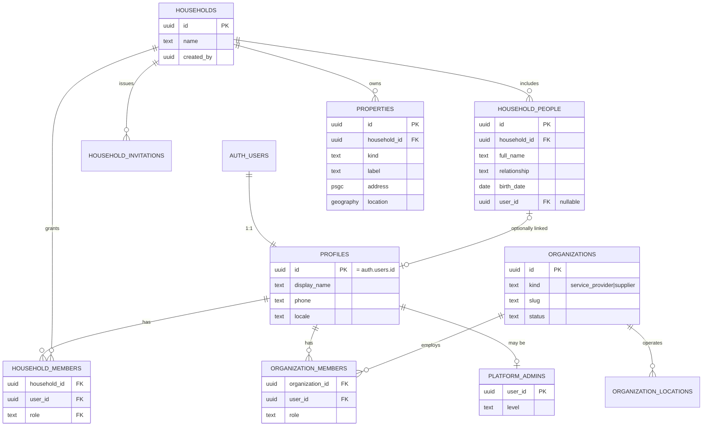
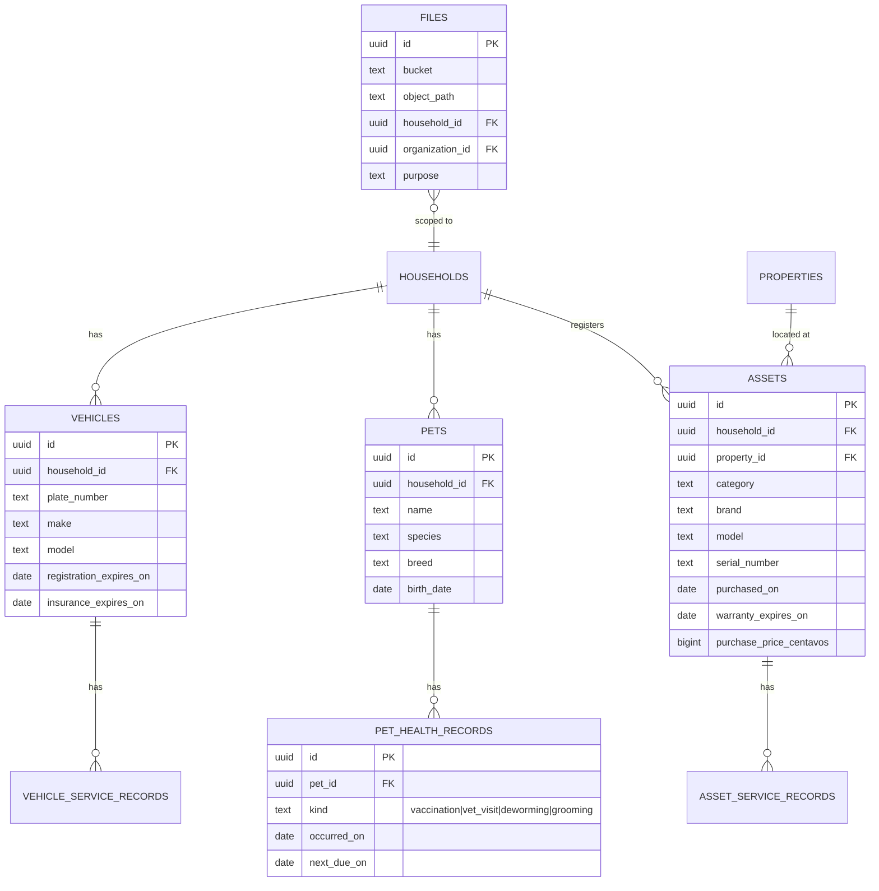
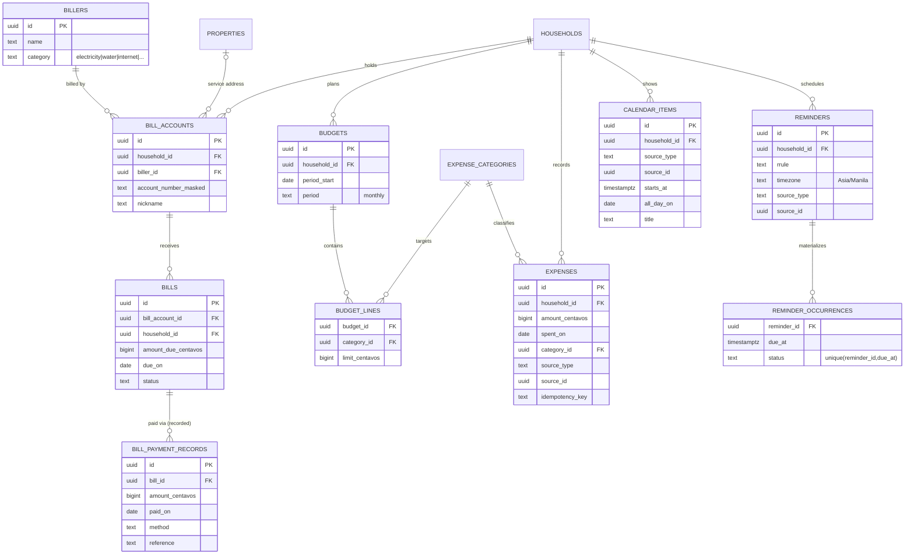
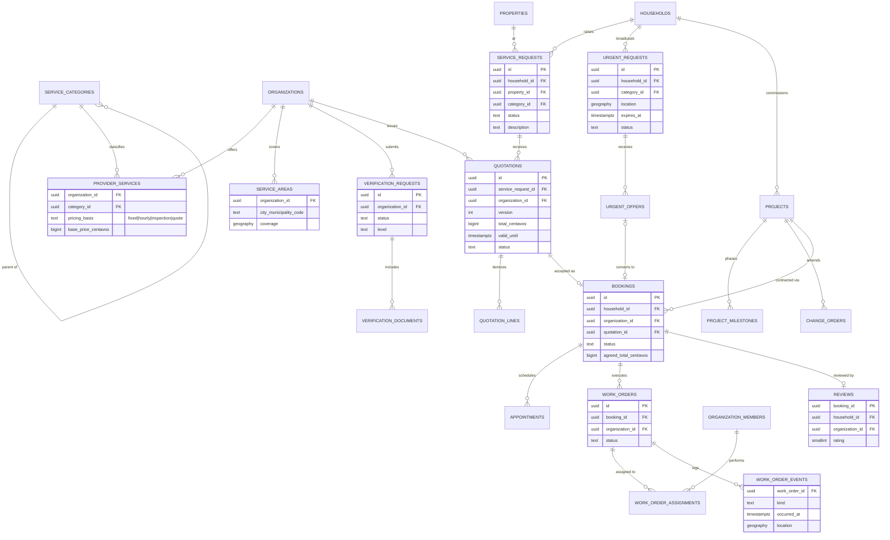
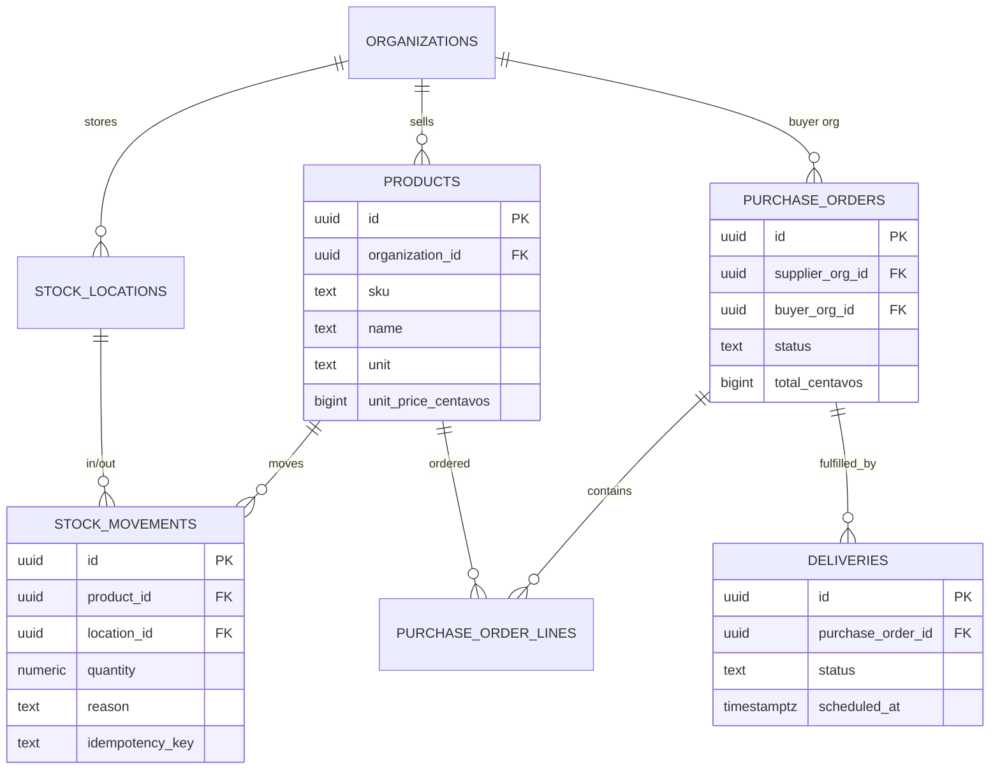
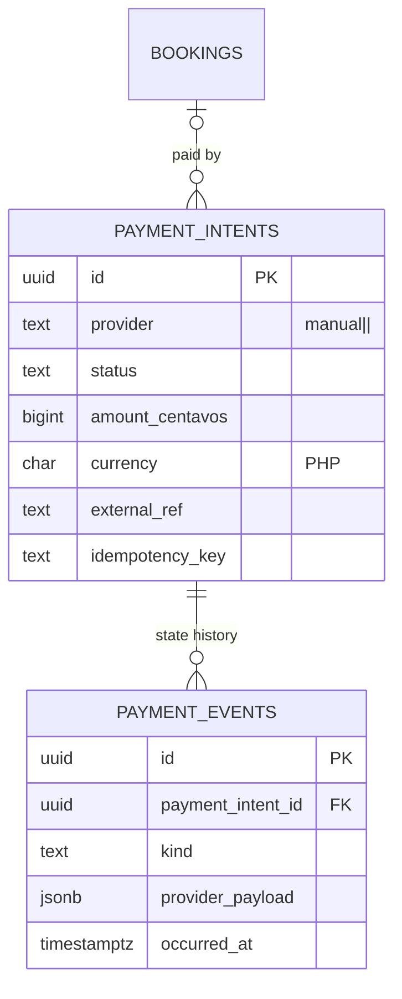

# 04 · Data Model

This is the **target** entity model across all phases. Each phase creates only the tables it needs, via migrations. Columns shown are the structurally important ones, not exhaustive.

## Conventions

| Topic          | Rule                                                                                                                                                                            |
| -------------- | ------------------------------------------------------------------------------------------------------------------------------------------------------------------------------- |
| Keys           | `id uuid primary key default gen_random_uuid()`                                                                                                                                 |
| Tenancy        | Tenant-owned rows carry `household_id` **or** `organization_id` (`not null`), indexed, used by RLS                                                                              |
| Timestamps     | `created_at timestamptz not null default now()`, `updated_at` via trigger; `created_by uuid references profiles` where useful                                                   |
| Soft delete    | `archived_at timestamptz` for user-facing records (pets, assets, vehicles); hard delete only for drafts                                                                         |
| Money          | `<name>_centavos bigint not null check (>= 0)` + `currency char(3) not null default 'PHP' check (currency = 'PHP')`. Never `numeric` floats in TS; never `real`/`double` in SQL |
| Dates          | Calendar facts (`due_on`, `birth_date`, `expires_on`) are `date`, interpreted in `Asia/Manila`. Instants are `timestamptz` (UTC)                                                |
| Enums          | Postgres `text` + `check` constraint (easier migrations than native enums), mirrored as Zod enums in contracts                                                                  |
| Addresses      | PSGC-based: `region_code`, `province_code`, `city_municipality_code`, `barangay_code` + `street_line`, `postal_code`, optional `location geography(Point)` (PostGIS)            |
| Schemas        | `public` = API-exposed tables with RLS. `private` = audit log, outbox, jobs, idempotency, helper functions — not exposed via PostgREST                                          |
| Sensitive data | Government ID numbers, account numbers stored masked + encrypted where retained (pgsodium/Vault or app-level), with retention policy                                            |

## Identity & tenancy



Role definitions: `roles`, `permissions`, `role_permissions` (seeded reference data, read-only to users).

**Key distinction:** `household_people` are the _people in the home_ (kids, elderly parents, kasambahay, driver) who may never log in; `household_members` are _user accounts with access_. A person can be linked to a profile when they get an account.

## Household registry (assets, pets, vehicles)



Attachments use a single `files` table (metadata for Storage objects) plus per-module link tables (e.g. `asset_files`). This is **not** a standalone Digital Home Vault — files exist only attached to approved records.

## Bills, budgeting, calendar



- `bill_payment_records` **record** payments made elsewhere (e.g. via GCash or at a payment centre). Direct utility payment is not approved.
- `expenses.source_type/source_id` trace derived expenses back to bills or work orders; `unique(household_id, idempotency_key)` prevents duplicate derivation.
- `reminder_occurrences` unique key makes reminder delivery idempotent.

## Marketplace, trust, service orders, dispatch, projects



**Cross-tenant records.** Bookings, quotations and work orders are shared between a household and an organization. Both IDs are on the row; RLS grants each side access according to its own role. Customer contact details and exact address are disclosed to the provider **only after** a booking is confirmed (privacy by design).

**State machines** live in the domain layer, are mirrored by `check` constraints, and transitions are validated in application services (not by arbitrary `update`). For example `bookings.status`: `pending_confirmation → confirmed → in_progress → completed | cancelled | disputed`.

## Supply & logistics



Stock is a **ledger** (`stock_movements`); on-hand quantity is a derived view/materialized summary, never an editable number.

## Platform tables (`private` schema)

| Table                                                                | Purpose                                                                                                                                   |
| -------------------------------------------------------------------- | ----------------------------------------------------------------------------------------------------------------------------------------- |
| `audit_logs` (public, admin-read only; inserts via definer function) | Append-only: `actor_id`, `action`, `target_type/id`, `household_id/organization_id`, `diff jsonb`, `request_id`, `ip_hash`, `occurred_at` |
| `outbox`                                                             | Domain events: `id`, `type`, `payload`, `occurred_at`, `dispatched_at`, `attempts`                                                        |
| `idempotency_keys`                                                   | `key`, `actor_id`, `scope`, `request_hash`, `response jsonb`, `expires_at`; unique `(actor_id, scope, key)`                               |
| `job_runs` / pgmq queues                                             | Durable jobs, attempts, dead letters                                                                                                      |
| `notifications` (public, RLS by recipient)                           | In-app notification inbox                                                                                                                 |

## Payments and the future wallet



```ts
// src/platform/payments/ports.ts (shape, not final)
export interface PaymentGateway {
  readonly provider: string;
  createIntent(input: {
    amount: Money;
    reference: string;
    idempotencyKey: string;
  }): Promise<Result<IntentRef, PaymentError>>;
  getStatus(ref: IntentRef): Promise<Result<PaymentStatus, PaymentError>>;
  refund(input: { ref: IntentRef; amount: Money; idempotencyKey: string }): Promise<Result<RefundRef, PaymentError>>;
  verifyWebhook(req: Request): Promise<Result<PaymentEvent, PaymentError>>;
}
```

The wallet, when approved, is implemented **by the licensed partner**; Bahay+ stores only references and statuses, never balances of record. No wallet tables exist until approval.
