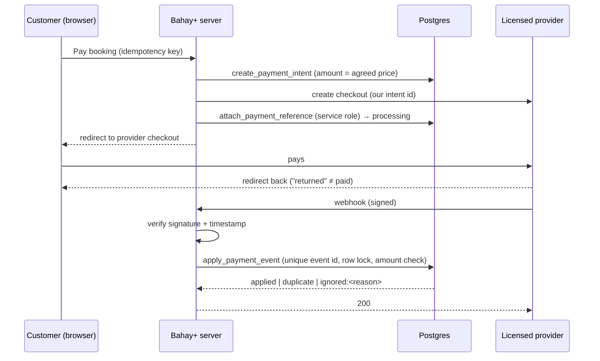

# 10 · Payments architecture and future PHP wallet

> **Status:** marketplace payment _architecture_ is implemented (Phase 10), and only a labelled local sandbox adapter exists. **No live gateway is connected, no funds are held, and no wallet functionality is active.** This document is the design of record for the payment flow that exists, and a proposal for a wallet that must not be built until the decisions in [§7](#7-decisions-required-before-launch-bsp-and-legal) are resolved.

## 1. Principles

1. **Bahay+ does not custody money.** A licensed partner collects from the customer and settles to the business. Bahay+ records what happened (D-07).
2. **PHP only, integer centavos.** Commission uses exact integer math (round half up of `amount × bps / 10 000`) in SQL (`private.commission_of`) and TypeScript (`commissionOf`). Both are covered by the same test cases.
3. **The server is the only source of truth for success.** An intent becomes `succeeded` only through `public.apply_payment_event`. Only the service role can call it, and only after the webhook signature has been verified. A browser redirect such as "payment complete" is just a hint: the UI shows _Confirming…_ until the verified event arrives.
4. **Every money movement is an append-only event.** `payment_events` has an immutability trigger. Sensitive commands also write `audit_logs`.
5. **Idempotency everywhere.**
   - Intents are unique per `(household, idempotency_key)`.
   - Refunds are unique per `(intent, idempotency_key)`.
   - External references are unique per provider.
   - Webhook event ids are unique per provider.
   - At most one live intent exists per booking.

## 2. Components (implemented)

| Piece                    | Where                                                                        |
| ------------------------ | ---------------------------------------------------------------------------- |
| Provider abstraction     | `modules/payments/domain/provider.ts` (`PaymentProvider`)                    |
| Local sandbox adapter    | `modules/payments/providers/sandbox.ts`, labelled "no real money"            |
| Webhook signatures       | `modules/payments/domain/webhooks.ts` (HMAC-SHA256, 5-min tolerance)         |
| Intents, refunds, events | migration `…001200_payments.sql`                                             |
| Commission rates         | `commission_rates` (platform default plus per-organization, not backdatable) |
| Settlements              | `settlements`, `settlement_items`, `create_settlement`                       |
| Reconciliation           | `reconciliation_runs`, `reconciliation_items`, `run_reconciliation`          |
| Webhook endpoint         | `POST /api/webhooks/payments/[provider]`                                     |

### Payment flow

### State machine

`requires_payment → processing → succeeded → partially_refunded → refunded`. From `processing`, failure leads to `failed`. `requires_payment` can be cancelled (`cancelled`).

- `succeeded` is terminal for payment events: a late `payment.failed` or a duplicate success is recorded as ignored and never downgrades it.
- Amount or currency mismatches are ignored and logged as `payment.amount_mismatch` for reconciliation.
- Concurrent events for one intent serialize on its row lock.

### Refunds

`request_refund` locks the intent and checks that pending plus succeeded refunds stay at or below the captured amount (`overrefund`). The provider confirms each refund by webhook. Partial refunds move the intent to `partially_refunded`; the final one moves it to `refunded`.

### Commission and settlement

- The commission rate (bps) is frozen on the intent at success.
- Settlement charges commission on what the customer kept paid: `commission = rate × (gross − refunded)`.
- A refund that succeeds after its payment was settled becomes a `refund_adjustment` in the next settlement: −refund, plus the commission share returned.
- Each payment and each refund is accounted for exactly once (unique indexes).
- Settlements move `draft → approved → paid_out`. `paid_out` records the partner's payout reference; Bahay+ does not move the money.

### Reconciliation

A platform finance user uploads the provider's transaction report for a period. Each line is compared with the ledger and classified as `matched`, `amount_mismatch`, `status_mismatch`, `missing_in_ledger`, or `missing_at_provider` (we think it was captured but the provider didn't report it). Runs are audited and kept.

### Access

- The household sees its own payments (`services.view`).
- The business sees payments received (`finance.view`). Owners and managers can refund (`payments.refund`).
- Platform `platform.finance.manage` (super admin, operations) runs settlements, reconciliation and commission changes.
- Nobody can write payment tables directly. Provider-facing functions are granted to the service role only.

## 3. Going live with a real provider (checklist)

1. Choose a BSP-supervised partner (payment gateway / EMI), for example one offering GCash, Maya, cards and InstaPay/PESONet collections with split settlement or sub-merchant payouts.
2. Implement `PaymentProvider` for it: checkout creation, refund, and `parseWebhook` with the provider's own signature scheme. Map its events to the four normalised event types.
3. Store secrets in the hosting secret manager: `PAYMENTS_PROVIDER`, API key, webhook secret. Never commit them.
4. Register the webhook URL. Confirm retries are idempotent; our unique event ids already make them so.
5. Daily: pull the provider settlement report and run reconciliation. Alert on any mismatch.
6. Have counsel review terms of service, refund policy and receipts (BIR invoicing for commission).

## 4. Future PHP wallet — design (not active)

> **Do not implement any of this until §7 is resolved.** Nothing below exists in code. No balances, top-ups, transfers, withdrawals or wallet payments are implemented, and none may be enabled by configuration.

### 4.1 Model: partner-held e-money, Bahay+ as front end

The funds sit in **e-money accounts issued by a licensed EMI partner**. Bahay+ holds no customer money. Its database keeps a **shadow ledger** that mirrors the partner's records so the app can show balances and reconcile. The partner's ledger is authoritative, and any disagreement is an incident.

### 4.2 Wallet accounts

- `wallet_accounts(id, owner_type household|organization, owner_id, partner_account_id unique, currency 'PHP', kyc_level, status active|frozen|closed, opened_at, closed_at)`.
- One account per owner per currency. Opening requires partner KYC at the right level. A household wallet belongs to a named, KYC'd adult member (the account holder), not the household as a whole.
- Accounts cannot be deleted. Closing requires a zero balance and partner confirmation.

### 4.3 Double-entry ledger

- `ledger_accounts`: one per wallet, plus system accounts: `partner_settlement`, `pending_topups`, `pending_payouts`, `fees`, `suspense`.
- `ledger_transactions(id, kind, idempotency_key unique, partner_reference unique, status, created_at)` and `ledger_entries(transaction_id, account_id, amount_centavos signed)`.
- Invariant: every transaction's entries sum to zero, enforced by a deferred constraint trigger. Entries are insert-only. Corrections are new reversing transactions.
- Balance equals the sum of entries per account, cached in a projection that is rebuilt and checked nightly against the sum.

### 4.4 Flows

| Flow                      | Entries (simplified)                                                                                                                                                                                      |
| ------------------------- | --------------------------------------------------------------------------------------------------------------------------------------------------------------------------------------------------------- |
| **Top-up**                | Partner confirms cash-in (verified webhook): `pending_topups −x / wallet +x`. Before confirmation, nothing is credited.                                                                                   |
| **Payment authorization** | Hold: `wallet −x / holds +x` (available balance drops; ledger balance doesn't). Capture: `holds −x / provider_wallet +(x − fee) / fees +fee`. Void: reverse the hold. Holds expire automatically.         |
| **Refund**                | `provider_wallet −x / customer_wallet +x` (plus fee reversal per policy). Capped by the captured amount, as with marketplace refunds today.                                                               |
| **Reversal**              | A new transaction mirroring the original (same accounts, opposite signs) and linked by `reverses_transaction_id`. Used for partner chargebacks and operator corrections; requires maker-checker approval. |
| **Payout to business**    | Executed by the partner to a verified bank/e-wallet: `provider_wallet −x / pending_payouts +x`, then `pending_payouts −x / partner_settlement +x` on confirmation.                                        |

Peer-to-peer transfers and consumer withdrawals stay **out of scope** unless separately approved; they carry different licensing and AML exposure.

### 4.5 Balance reconciliation

- Daily: the partner balance file per account compared with the shadow ledger balance. Any difference goes to `suspense` and opens an incident. Accounts with unexplained differences are frozen.
- Intraday: every partner webhook is matched to exactly one ledger transaction by `partner_reference`. Unmatched items after a set window raise an alert.
- Totals: the sum of all customer wallet balances must equal the partner-reported e-money float attributable to Bahay+ users.

### 4.6 Transaction limits

Limits are enforced in the database and also by the partner. They are configurable per KYC level and are placeholders pending partner and BSP guidance:

- per-transaction maximum, daily and monthly outflow, and monthly inflow per account;
- a velocity limit (count per hour) and a new-account cooling-off period;
- a maximum wallet balance per KYC tier.

Breaches are refused, not queued.

### 4.7 Wallet security

- Step-up authentication (passkey or OTP) for any outflow, holds above a threshold, and device changes.
- Device binding and session risk signals; freeze on suspected account takeover.
- All money commands are idempotent SQL functions with row locks, called only by the server. No direct table writes.
- Maker-checker for reversals, manual adjustments and limit overrides. Every admin action is audited.
- Secrets in a managed vault with rotation. Webhook signature verification and replay protection as in §2.
- Fraud monitoring: rules first (velocity, amount anomalies, many accounts per device), with a review queue.
- Data minimisation: no full card or account numbers stored. Partner tokens only.

### 4.8 Licensed partner integration

- The partner provides KYC/eKYC, e-money issuance, cash-in channels, payouts, AML screening, transaction monitoring and regulatory reporting.
- Bahay+ integrates through a `WalletPartner` port, the counterpart of `PaymentProvider`: `openAccount`, `getBalance`, `createTopUp`, `authorize`, `capture`, `void`, `refund`, `payout`, `parseWebhook`, plus a daily statement download for reconciliation.
- Contracts must define who bears chargeback and fraud loss, settlement timing (T+n), dispute SLAs, data sharing under the Data Privacy Act, and business-continuity obligations.

## 5. What is deliberately not built

- No stored value, balances, top-ups, wallet payments, transfers or withdrawals.
- No card data handling (the provider hosts checkout).
- No automatic payouts. Settlements are records, and payouts are executed by the partner.

## 6. Testing (implemented)

`tests/security/payments.test.ts` covers:

- duplicate webhooks and replay attempts (stale timestamp, altered body, reused event id);
- concurrent success and failure events for one intent;
- partial and over-refunds, and failed payment states;
- settlement maths, including post-settlement refund adjustments;
- reconciliation mismatches;
- cross-tenant access to intents, refunds and settlements.

Unit tests cover commission rounding and signature verification.

## 7. Decisions required before launch (BSP and legal)

These are open decisions with owners, not legal advice. Counsel experienced with BSP regulation must confirm each one.

| #    | Decision                                                                                                                                                                                                                                        | Why it matters                                                          |
| ---- | ----------------------------------------------------------------------------------------------------------------------------------------------------------------------------------------------------------------------------------------------- | ----------------------------------------------------------------------- |
| P-1  | **Is Bahay+ an Operator of a Payment System (OPS)** under the National Payment Systems Act (RA 11127), given marketplace collections and split settlements? Does registration with the BSP apply, or does the partner's license cover the flow? | Determines whether BSP registration is required before taking payments. |
| P-2  | **Partner model:** a licensed payment gateway with sub-merchant/split settlement vs. an EMI for any future wallet. Confirm the partner's BSP licenses (EMI, OPS registration) and their scope.                                                  | Bahay+ must never appear to issue e-money or accept deposits itself.    |
| P-3  | **Wallet issuer:** e-money issuance requires an EMI license (BSP e-money rules). Confirm Bahay+ will only front a partner-issued wallet, and how the account relationship, branding and disclosures are presented.                              | Unlicensed e-money issuance is prohibited.                              |
| P-4  | **AML/CFT obligations** (AMLA as amended; BSP AML rules): who is the covered person, who performs KYC/CDD, transaction monitoring and suspicious/covered transaction reporting to AMLC, and what records Bahay+ must keep.                      | Drives KYC tiers, limits and data retention.                            |
| P-5  | **Consumer protection** (Financial Products and Services Consumer Protection Act, RA 11765; BSP consumer protection rules): complaint handling, disclosures, refund timelines and dispute escalation.                                           | Requires a documented complaints process and customer-facing terms.     |
| P-6  | **Transaction limits and KYC tiers** for any wallet: align with partner and BSP thresholds before enabling.                                                                                                                                     | Limits in §4.6 are placeholders.                                        |
| P-7  | **Information security and outsourcing:** BSP IT risk and outsourcing expectations for partners and for Bahay+ as a technology provider. Includes penetration testing, incident reporting timelines and data residency.                         | May require controls beyond the current baseline.                       |
| P-8  | **Data privacy** (Data Privacy Act, RA 10173; NPC registration): payment data sharing with the partner, retention and DPO designation.                                                                                                          | Affects contracts and the privacy notice.                               |
| P-9  | **Tax:** BIR invoicing for platform commission, withholding obligations on payouts to businesses, and documentary requirements.                                                                                                                 | Settlement statements may need BIR-compliant invoices.                  |
| P-10 | **Chargebacks and disputes:** liability split between partner, Bahay+ and businesses; reserve or holdback policy for new businesses.                                                                                                            | Determines whether settlements need reserves before payout.             |

Until P-1 to P-4 are closed, production keeps `PAYMENTS_PROVIDER` unset: online payment buttons stay hidden, and bookings continue with off-platform payment as today.
